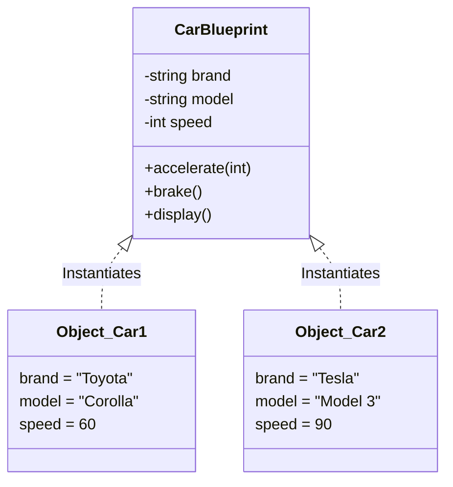
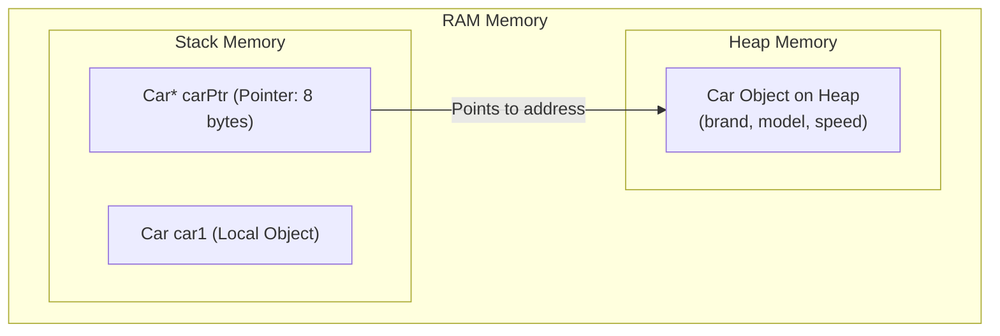
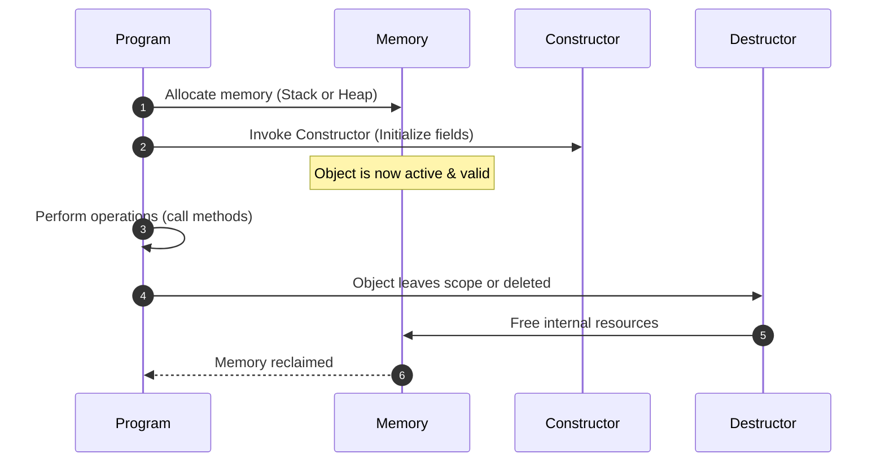

# Module 01: Classes and Objects

## 1. Core Theory & Definitions

### 1.1 What is Object-Oriented Programming (OOP)?
Object-Oriented Programming is a programming paradigm based on the concept of **objects**, which contain:
1. **Attributes / State:** Data represented as member variables.
2. **Behaviors / Operations:** Functions that act upon that data (member functions or methods).

Unlike Procedural Programming (which focuses on functions operating on detached data), OOP binds data and functions together into self-contained models that reflect real-world entities.

---

### 1.2 Class vs Object

| Concept | Definition | Analogy | Memory Allocated? |
| :--- | :--- | :--- | :--- |
| **Class** | A user-defined data type / blueprint defining structure and behavior. | Architectural blueprint of a house. | No (it is only a type definition). |
| **Object** | A specific concrete instance of a class loaded into memory. | A physical house built from the blueprint. | Yes (occupies stack or heap memory). |



---

### 1.3 Memory Layout: Stack vs Heap Allocation



- **Stack Allocation (`Car car1;`):**
  - Fast allocation and automatic deallocation when the variable goes out of scope.
  - Size must be known at compile time.
- **Heap Allocation (`Car* carPtr = new Car();`):**
  - Dynamically allocated at runtime using `new`.
  - Must be explicitly freed with `delete carPtr;` to prevent **memory leaks**.

---

### 1.4 Access Specifiers

Access specifiers control which parts of a program can read or modify a class's members:

- **`private` (Default for C++ classes):** Accessible *only* within member functions of the class itself.
- **`public`:** Accessible from *anywhere* in the program where the object is accessible.
- **`protected`:** Accessible within the class itself and by *derived (child) classes*.

---

### 1.5 Object Lifecycle & Constructors

A **Constructor** is a special member function automatically called when an object is created.
- Has the **exact same name** as the class.
- Has **no return type** (not even `void`).



#### Types of Constructors:
1. **Default Constructor:** Accepts no parameters (or has default values for all parameters).
2. **Parameterized Constructor:** Accepts arguments to initialize specific values.
3. **Member Initializer List:**
   ```cpp
   // PREFERRED: Directly initializes members without default-constructing first
   Car(std::string b, int s) : brand(b), speed(s) {}
   ```
4. **Copy Constructor:** Creates an object by copying an existing object of the same type:
   ```cpp
   Car(const Car& other);
   ```

---

### 1.6 The `this` Pointer
Inside any non-static member function, `this` is a hidden pointer pointing to the current object invoking the function:
```cpp
void setSpeed(int speed) {
    this->speed = speed; // Resolves naming conflict between parameter and attribute
}
```

---

## 2. Code Files in this Folder

- [`01_class_and_object_basics.cpp`](file:///F:/MY%20CLASS/ALL%20OF%20MY%20PROJECTS/cpp-oop/01-classes-and-objects/01_class_and_object_basics.cpp): Class definition, methods, stack vs heap.
- [`02_constructors_and_destructor.cpp`](file:///F:/MY%20CLASS/ALL%20OF%20MY%20PROJECTS/cpp-oop/01-classes-and-objects/02_constructors_and_destructor.cpp): Default, parameterized, member initializer list, destructor scope.
- [`03_copy_constructor.cpp`](file:///F:/MY%20CLASS/ALL%20OF%20MY%20PROJECTS/cpp-oop/01-classes-and-objects/03_copy_constructor.cpp): Copy constructor and pass-by-value demonstration.

---

## 3. Practice Challenges

1. Create a `Student` class with attributes `name`, `rollNumber`, and `marks`. Write member functions to calculate grade and display student profile.
2. Implement a `Time` class with hours, minutes, and seconds. Write a member function `addTime(Time t2)` that adds two time objects correctly handling 60-second and 60-minute rollovers.
