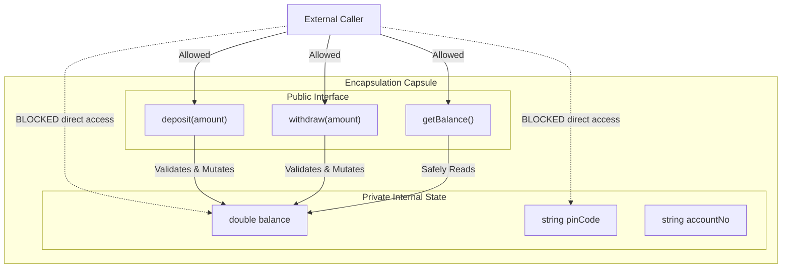
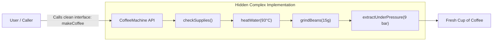

# Module 02: Encapsulation & Abstraction

## 1. Core Theory & Definitions

Encapsulation and Abstraction are two foundational pillars of OOP that work together to create robust, maintainable, and secure software.

---

### 1.1 What is Encapsulation?
**Encapsulation** is the bundling of data (attributes) and methods (behaviors) into a single unit (class), while restricting direct access to the internal state from the outside world.

#### Why Encapsulation Matters:
1. **Data Hiding & Protection:** Prevents unauthorized direct modification of sensitive state (e.g., setting account balance to negative numbers or modifying an account ID).
2. **Invariants & Validation:** Setters enforce validation rules before changing state.
3. **Flexibility & Refactoring:** Internal implementation can change (e.g., storing balance in cents instead of dollars) without breaking external code.

---

### 1.2 What is Abstraction?
**Abstraction** means exposing only the essential, high-level features of an object while hiding the underlying complexity and execution details from the user.

#### Real-World Analogy:
- **Driving a Car:** You press the accelerator pedal. You do not need to know the fuel injection timing, cylinder pressure, or throttle valve angle. The pedal is the **abstraction**; the engine mechanics are the **hidden implementation**.

---

### 1.3 Key Differences: Encapsulation vs Abstraction

| Aspect | Encapsulation | Abstraction |
| :--- | :--- | :--- |
| **Primary Goal** | **Data Protection:** Hiding internal data to maintain validity. | **Complexity Reduction:** Hiding implementation details to simplify usage. |
| **Focus** | Focuses on *how* an object works internally and protects its state. | Focuses on *what* an object does from an outside perspective. |
| **Implementation** | Achieved through `private`/`protected` access specifiers and getters/setters. | Achieved through interfaces, abstract classes, and modular function signatures. |
| **Level** | Implementation-level concern. | Design-level concern. |

---

## 2. Code Files in this Folder

- [`01_encapsulation.cpp`](file:///F:/MY%20CLASS/ALL%20OF%20MY%20PROJECTS/cpp-oop/02-encapsulation-abstraction/01_encapsulation.cpp): Complete BankAccount class showing private fields, guarded getters, and validated mutators.
- [`02_abstraction.cpp`](file:///F:/MY%20CLASS/ALL%20OF%20MY%20PROJECTS/cpp-oop/02-encapsulation-abstraction/02_abstraction.cpp): CoffeeMachine model demonstrating complex internal steps triggered by a single clean public method.

---

## 3. Practice Challenges

1. **Secure Wallet:** Create an `EWallet` class with a private balance and daily transaction limit. Allow deposits and transactions only if they pass validation checks.
2. **Smart Thermostat:** Create a `SmartThermostat` class that exposes simple commands like `setTargetTemperature(int t)`, while internally abstracting HVAC compressor control, sensor calibration, and power efficiency modes.
