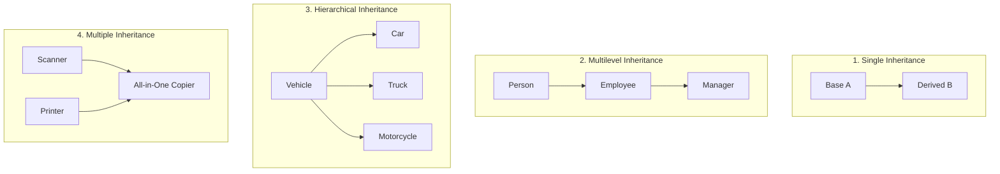
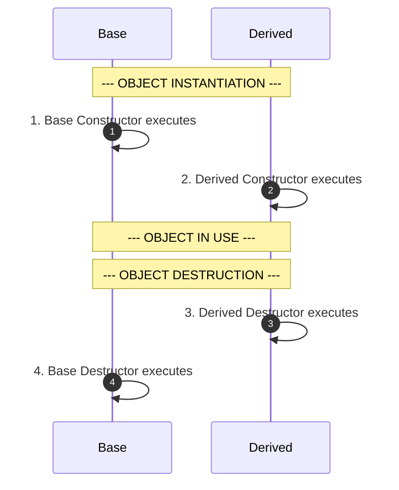
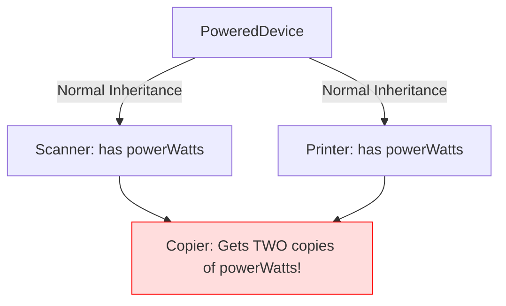
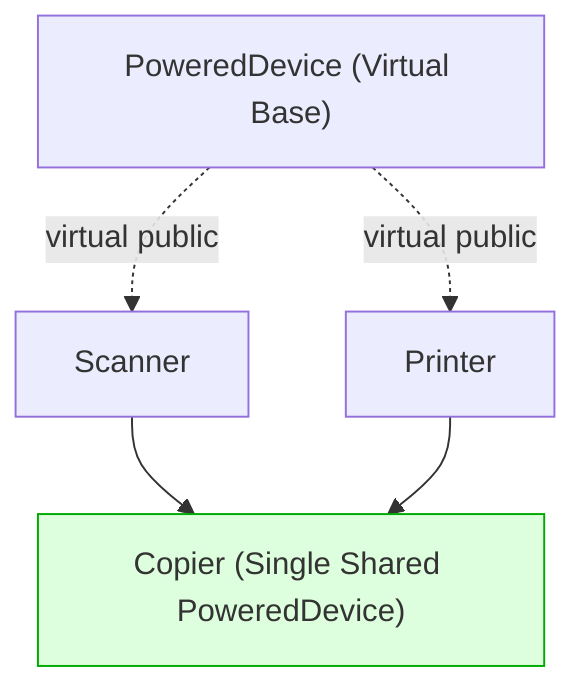

# Module 03: Inheritance

## 1. Core Theory & Definitions

### 1.1 What is Inheritance?
**Inheritance** is a mechanism where a new class (known as the **Derived / Child** class) acquires properties and behaviors from an existing class (known as the **Base / Parent** class).

- Models an **"IS-A"** relationship (e.g., a `Dog` IS-A `Animal`, a `Manager` IS-A `Employee`).
- Promotes **code reusability**, extensibility, and maintainability.

---

### 1.2 Types of Inheritance



---

### 1.3 Access Specifiers in Inheritance Modes

The mode of inheritance determines the accessibility of inherited members in the derived class:

| Base Class Member | Public Inheritance (`: public Base`) | Protected Inheritance (`: protected Base`) | Private Inheritance (`: private Base`) |
| :--- | :--- | :--- | :--- |
| **`public`** | Remains **`public`** in Derived | Becomes **`protected`** in Derived | Becomes **`private`** in Derived |
| **`protected`** | Remains **`protected`** in Derived | Remains **`protected`** in Derived | Becomes **`private`** in Derived |
| **`private`** | **Not Accessible** directly | **Not Accessible** directly | **Not Accessible** directly |

> [!TIP]
> In 95% of real-world C++ OOP programming, **`public` inheritance** is used because it correctly models the true **"IS-A"** relationship.

---

### 1.4 Constructor and Destructor Call Order

When an object of a derived class is created:
1. **Base Class Constructor** executes **FIRST**.
2. **Derived Class Constructor** executes **SECOND**.

When the object is destroyed:
1. **Derived Class Destructor** executes **FIRST**.
2. **Base Class Destructor** executes **SECOND** (reverse order of creation).



---

### 1.5 The Diamond Problem & Virtual Inheritance

The **Diamond Problem** occurs in multiple inheritance when a class inherits from two classes that share a common base:



#### The Conflict:
`Copier` receives two separate copies of `PoweredDevice`, causing:
1. Ambiguity (`copier.powerWatts` fails to compile: which one?).
2. Wasted memory.

#### The Solution: Virtual Base Classes


Syntax:
```cpp
class Scanner : virtual public PoweredDevice { /* ... */ };
class Printer : virtual public PoweredDevice { /* ... */ };
class Copier : public Scanner, public Printer { /* ... */ };
```

---

## 2. Code Files in this Folder

- [`01_single_and_multilevel.cpp`](file:///F:/MY%20CLASS/ALL%20OF%20MY%20PROJECTS/cpp-oop/03-inheritance/01_single_and_multilevel.cpp): Single (`Person -> Employee`) and Multilevel (`Person -> Employee -> Manager`) with constructor/destructor logs.
- [`02_multiple_and_hierarchical.cpp`](file:///F:/MY%20CLASS/ALL%20OF%20MY%20PROJECTS/cpp-oop/03-inheritance/02_multiple_and_hierarchical.cpp): Multiple inheritance with `PoweredDevice`, `Scanner`, `Printer`, and `Copier` demonstrating virtual base class resolution.

---

## 3. Practice Challenges

1. Create a `Vehicle` base class (`speed`, `fuelCapacity`). Derive a `Car` class (`numDoors`), and derive `ElectricCar` from `Car` (`batteryLevel`, `charge()`). Trace constructor and destructor outputs.
2. Implement a `Teacher` and `Researcher` class, and derive `Professor` from both using multiple inheritance.
