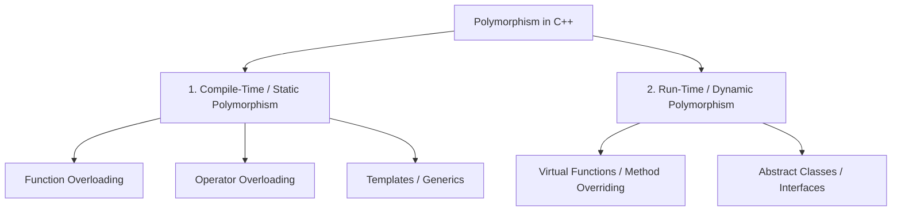
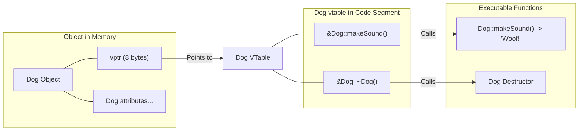

# Module 04: Polymorphism

## 1. Core Theory & Definitions

### 1.1 What is Polymorphism?
**Polymorphism** originates from Greek: *Poly* (Many) + *Morph* (Forms). In programming, it represents the ability of a single interface or function name to exhibit different behaviors based on the underlying object or data type.



---

### 1.2 Compile-Time vs Run-Time Polymorphism

| Feature | Compile-Time (Static Binding) | Run-Time (Dynamic Binding) |
| :--- | :--- | :--- |
| **Resolution Time** | Determined at compilation time. | Resolved at runtime during program execution. |
| **Mechanism** | Function signature matching / Name Mangling. | Virtual Table (`vtable`) and Virtual Pointer (`vptr`). |
| **Execution Speed** | Faster (zero runtime overhead). | Minor pointer dereference overhead. |
| **Flexibility** | Less flexible with heterogeneous collections. | High flexibility: allows base pointers to manage diverse derived objects. |

---

### 1.3 Under the Hood: The VTable & VPtr Mechanism

When a class declares or inherits a `virtual` function:
1. The compiler creates a static table of function pointers for that class called the **`vtable` (Virtual Table)**.
2. Every instance of that class gets a hidden pointer member called the **`vptr` (Virtual Pointer)** pointing to that class's `vtable`.



When you call `animalPtr->makeSound()`:
1. Program reads `animalPtr->vptr`.
2. Locates the `makeSound` entry in the corresponding `vtable`.
3. Jumps to the actual derived function (`Dog::makeSound`).

---

### 1.4 The Critical Rule: Virtual Destructors

> [!WARNING]
> If a class has at least one virtual function, **its destructor MUST also be declared `virtual`**.

Without a virtual destructor:
```cpp
Animal* a = new Dog();
delete a; // UNDEFINED BEHAVIOR & MEMORY LEAK! Only Animal destructor runs. Dog destructor is skipped!
```

With a virtual destructor (`virtual ~Animal() = default;`):
1. `Dog` destructor executes first.
2. `Animal` destructor executes second.
3. All resources are safely freed.

---

### 1.5 Pure Virtual Functions & Abstract Classes

- **Pure Virtual Function:** A function declared with `= 0`:
  ```cpp
  virtual void draw() const = 0;
  ```
- **Abstract Class:** A class containing at least one pure virtual function. It **cannot be instantiated** directly (`Shape s;` is invalid).
- Serves as a contract / interface that derived classes must fulfill.

---

## 2. Code Files in this Folder

- [`01_compile_time_polymorphism.cpp`](file:///F:/MY%20CLASS/ALL%20OF%20MY%20PROJECTS/cpp-oop/04-polymorphism/01_compile_time_polymorphism.cpp): Function overloading and 2D vector operator overloading (`+`, `-`, `==`, `<<`).
- [`02_runtime_polymorphism_virtual.cpp`](file:///F:/MY%20CLASS/ALL%20OF%20MY%20PROJECTS/cpp-oop/04-polymorphism/02_runtime_polymorphism_virtual.cpp): Animal hierarchy (`Dog`, `Cat`) using virtual methods and virtual destructors.
- [`03_abstract_classes_interfaces.cpp`](file:///F:/MY%20CLASS/ALL%20OF%20MY%20PROJECTS/cpp-oop/04-polymorphism/03_abstract_classes_interfaces.cpp): Shape interface with `Circle` and `Rectangle` implementing pure virtual methods.

---

## 3. Practice Challenges

1. Create a `PaymentGateway` abstract class with pure virtual `processPayment(double amount)` and `refund(double amount)`. Implement concrete classes `CreditCard`, `PayPal`, and `CryptoPayment`.
2. Overload the `*` operator for a `Matrix` class to perform 2x2 matrix multiplication.
