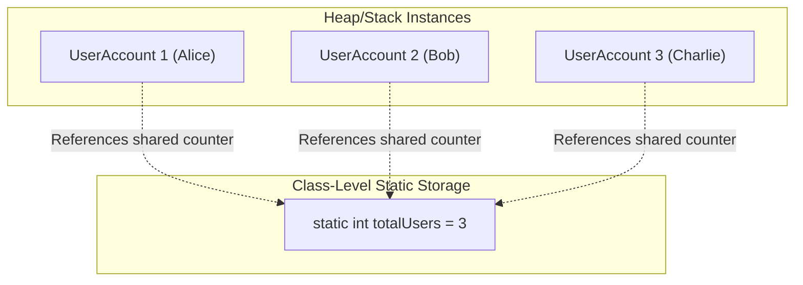
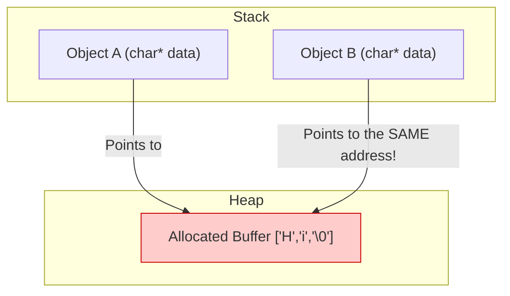
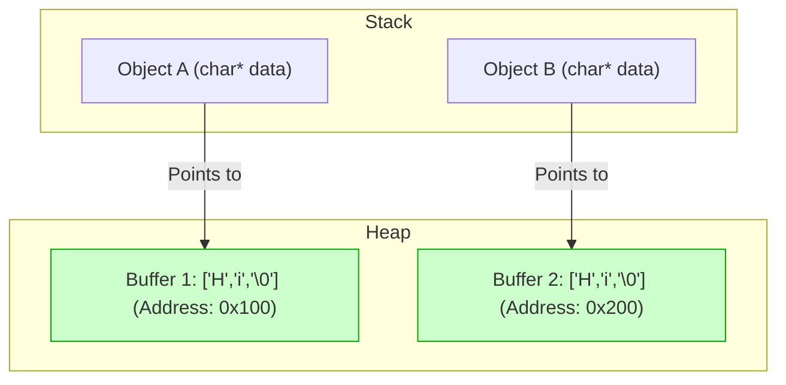

# Module 05: Advanced OOP Concepts & Memory Management

## 1. Core Theory & Definitions

### 1.1 Static Members & Static Methods

In C++, the `static` keyword changes the lifetime and scope of class members:

- **Static Member Variable:**
  - Belongs to the **class as a whole**, not to any single instance.
  - Stored in the static data segment, allocated once when the program starts.
  - Shared across all objects of that class.
  - **Must be defined outside the class** in a `.cpp` file.

- **Static Member Function:**
  - Can be invoked without creating an object: `ClassName::staticMethod()`.
  - Has **no `this` pointer**.
  - Can **only access other static members** (cannot access non-static attributes).



---

### 1.2 Friend Functions & Friend Classes

The `friend` keyword allows a non-member function or external class to access `private` and `protected` members of the granting class:

```cpp
class Box {
private:
    double width, height, depth;

public:
    // Declare friend function
    friend void inspectBox(const Box& b);

    // Declare friend class
    friend class BoxAuditor;
};
```

> [!NOTE]
> Friendship is:
> - **Not mutual:** If class A is a friend of class B, class B is NOT automatically a friend of class A.
> - **Not inherited:** Derived classes do not inherit friendship.
> - **Not transitive:** If A is a friend of B, and B is a friend of C, A is NOT a friend of C.

---

### 1.3 Deep Copy vs Shallow Copy & The Rule of Three

When a class manages dynamically allocated resources (e.g. raw pointers allocated with `new`), default member-wise copying creates severe bugs.

#### The Shallow Copy Bug:
The default copy constructor and assignment operator simply copy pointer addresses (shallow copy):



1. Both `ObjA` and `ObjB` point to the exact same buffer on the heap.
2. When `ObjA` is destroyed, its destructor frees `Buffer`.
3. When `ObjB` is destroyed, its destructor attempts to free the already-freed buffer -> **DOUBLE-FREE CRASH / UNDEFINED BEHAVIOR**!

#### The Deep Copy Solution:
A custom copy constructor allocates a **new, independent block of memory** on the heap and duplicates the contents:



---

### 1.4 The Rule of Three

> [!IMPORTANT]
> **The Rule of Three:** If your class requires a custom implementation of any of the following three, it almost certainly requires all three:
> 1. **Destructor (`~ClassName()`)**: To release dynamic resources.
> 2. **Copy Constructor (`ClassName(const ClassName& other)`)**: To perform a deep copy upon initialization.
> 3. **Copy Assignment Operator (`ClassName& operator=(const ClassName& other)`)**: To perform a deep copy upon assignment and safely clean up existing resources.

---

## 2. Code Files in this Folder

- [`01_static_members.cpp`](file:///F:/MY%20CLASS/ALL%20OF%20MY%20PROJECTS/cpp-oop/05-advanced-oop/01_static_members.cpp): Static variable tracking instance count and static member functions.
- [`02_friend_function_and_class.cpp`](file:///F:/MY%20CLASS/ALL%20OF%20MY%20PROJECTS/cpp-oop/05-advanced-oop/02_friend_function_and_class.cpp): Friend function and friend inspector class accessing private dimensions.
- [`03_deep_vs_shallow_copy.cpp`](file:///F:/MY%20CLASS/ALL%20OF%20MY%20PROJECTS/cpp-oop/05-advanced-oop/03_deep_vs_shallow_copy.cpp): DynamicString class implementing the full Rule of Three with deep copy allocation.

---

## 3. Practice Challenges

1. Create a `SmartArray` class that dynamically allocates an integer array of arbitrary size on the heap. Implement the complete **Rule of Three** (Destructor, Copy Constructor, Assignment Operator).
2. Create a `ConnectionPool` class with static methods and variables that limits the maximum number of concurrent active database connections to 5.
