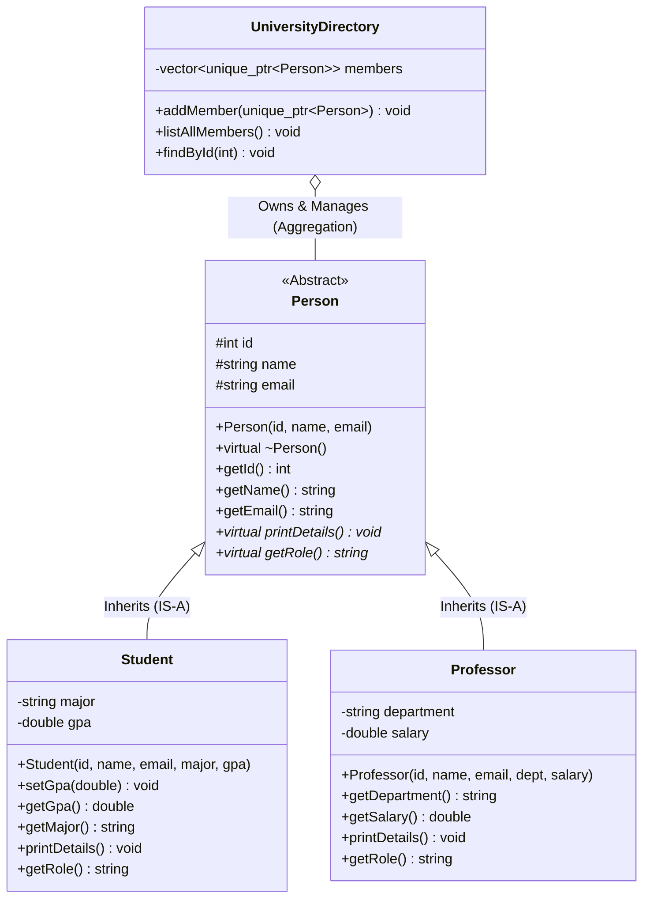
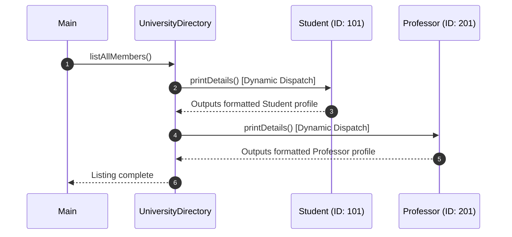

# Module 06: Capstone Practice Project

## 1. System Overview: University Member Directory

The **University Member Directory** is a capstone application designed to demonstrate how all four pillars of Object-Oriented Programming (Encapsulation, Abstraction, Inheritance, and Polymorphism) collaborate in a cohesive, real-world C++ system.

---

## 2. Architecture & Class Diagram



---

## 3. The 4 Pillars in Action

### 1. Encapsulation
- Sensitive fields like `gpa`, `salary`, `id`, and `email` are encapsulated (`private`/`protected`).
- `Student::setGpa` verifies that the value falls within the valid range `[0.0, 4.0]`. Direct state corruption is impossible.

### 2. Abstraction
- The `Person` class exposes high-level pure virtual functions (`printDetails()`, `getRole()`), hiding specific formatting mechanics from `UniversityDirectory`.
- Callers of `UniversityDirectory` simply invoke `listAllMembers()` or `findById()`.

### 3. Inheritance
- `Student` and `Professor` inherit shared characteristics (`id`, `name`, `email`) from `Person`, eliminating duplicated code and establishing a logical hierarchy.

### 4. Polymorphism
- `UniversityDirectory` stores generic `std::unique_ptr<Person>` pointers.
- When iterating through the collection:
  ```cpp
  member->printDetails();
  ```
  The C++ runtime automatically dispatches the call to `Student::printDetails()` or `Professor::printDetails()` based on the actual object type in memory.

---

## 4. Sequence Diagram: Polymorphic Listing



---

## 5. Code File

- [`student_management_system.cpp`](file:///F:/MY%20CLASS/ALL%20OF%20MY%20PROJECTS/cpp-oop/06-practice-projects/student_management_system.cpp)

### Compiling & Running:
```powershell
cd "F:\MY CLASS\ALL OF MY PROJECTS\cpp-oop\06-practice-projects"
g++ -std=c++17 student_management_system.cpp -o student_system.exe
.\student_system.exe
```

---

## 6. Project Expansion Challenges

Ready to practice? Try extending this project:
1. **Add a `Staff` Class:** Derive `Staff` from `Person` with a `jobTitle` attribute and appropriate overrides.
2. **Interactive CLI Menu:** Replace the static `main()` calls with a `while(true)` terminal menu allowing user input to add students or professors interactively.
3. **File Persistence:** Add an `exportToFile()` and `importFromFile()` method to save and load directory records using `std::fstream`.
4. **Course Enrollment:** Create a `Course` class (`courseCode`, `courseName`, `credits`) and allow students to enroll in courses.
